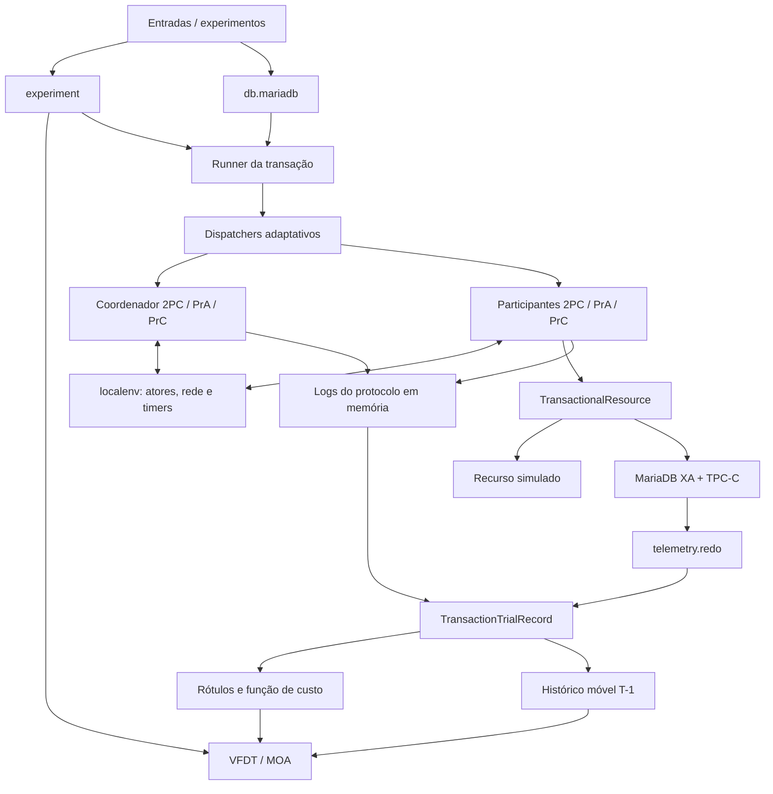
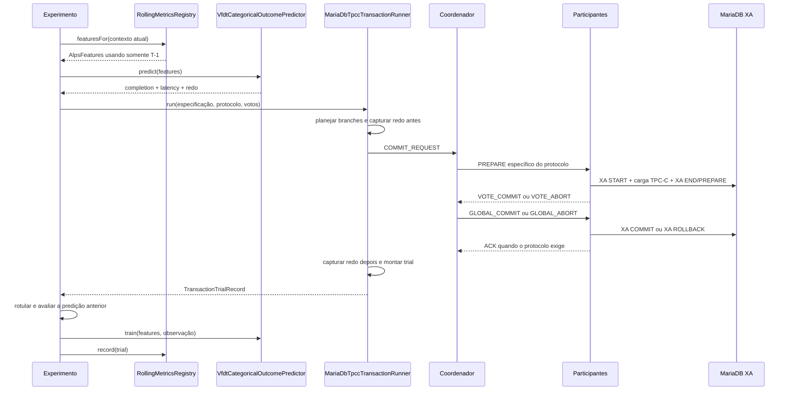
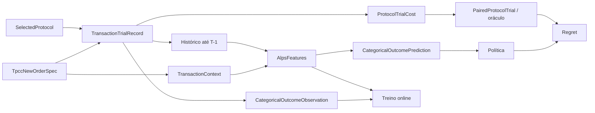

# Mapa do código — ACPLogLearner

## 1. O projeto em uma frase

O ACPLogLearner é um protótipo de pesquisa que executa transações distribuídas com
três variantes de atomic commit, mede o custo de cada execução e usa aprendizado
online (VFDT/Hoeffding Tree) para recomendar o protocolo mais adequado ao contexto
da próxima transação.

As três variantes disponíveis são:

- `TWO_PC`: Two-Phase Commit clássico;
- `TWO_PC_PRESUMED_ABORT`: 2PC com presumed abort (PrA);
- `TWO_PC_PRESUMED_COMMIT`: 2PC com presumed commit (PrC).

## 2. Visão arquitetural



O pacote `protocol` não conhece MariaDB, TPC-C nem aprendizado de máquina. Ele
depende apenas de abstrações de rede, timer, log e `TransactionalResource`. Essa é
a separação mais importante do desenho.

## 3. Fluxo principal de uma transação real

O caminho mais representativo começa em `MariaDbAlpsMain` ou
`MariaDbDefensibleExperimentMain`:



A ordem `predizer -> executar -> avaliar -> treinar -> atualizar histórico` evita
vazamento temporal: dados gerados pela transação T só podem influenciar T+1 em
diante.

## 4. Pontos de entrada

| Entrada | Tarefa Gradle | Papel |
|---|---|---|
| `ufc.victor.Main` | execução direta | Demonstração antiga, totalmente simulada, das máquinas de estados. |
| `experiment.ExperimentRunner` | `runExperiment` | Experimento online simulado/legado com cenários e VFDT de um único rótulo. |
| `ufc.victor.MariaDbMain` | `runMariaDbDemo` | Demonstra 2PC e XA em uma instância MariaDB usando uma tabela journal. |
| `ufc.victor.MariaDbTpccClusterMain` | `runMariaDbTpccCluster` | Smoke test de New-Order distribuído no cluster de quatro shards. |
| `ufc.victor.MariaDbAlpsMain` | `runMariaDbAlps` | Baseline prequential multi-head: recomenda entre três protocolos, mas executa e aprende somente com 2PC clássico. |
| `ufc.victor.MariaDbDefensibleExperimentMain` | `runMariaDbDefensibleExperiment` | Experimento principal: trials pareados dos três protocolos, restauração do estado, oráculo, regret, múltiplas seeds e CSVs. |

Comandos básicos:

```bash
./gradlew test
./gradlew runExperiment
docker compose up -d
./scripts/benchmarksql.sh load-all
./gradlew runMariaDbTpccCluster
./gradlew runMariaDbAlps
./gradlew runMariaDbDefensibleExperiment
```

Os executáveis MariaDB são configurados principalmente por variáveis `ACP_*`.
Os defaults do cluster apontam para `127.0.0.1:33061` até `33064`.

## 5. Pacotes e responsabilidades

### `ufc.victor.protocol` — o núcleo de atomic commit

#### Abstrações (`protocol/abstractions`)

- `IProtocol`: contrato comum de protocolo.
- `ICoordinator` e `IParticipant`: papéis das duas pontas do commit.
- `IMessageHandler` e `ITimeoutHandler`: portas de entrada para eventos.
- `events/*`: envelope de mensagem, timeout e controle usado pelos atores.

#### Tipos comuns (`protocol/commom`)

> O diretório se chama `commom` no código (não `common`), portanto os imports
> devem conservar essa grafia.

- `TransactionId`: identidade UUID da transação.
- `Network`: porta para envio de mensagens.
- `ITimer` / `ITimerFactory`: abstrações de timeout.
- `ILogManager<T>`: armazenamento do log do protocolo.
- `message/Message`: tipo, transação, origem, destino, payload e timestamp.
- `message/MessageType`: vocabulário da conversa (`PREPARE_*`, votos, decisão e `ACK`).
- `SelectedProtocol`: enum que escolhe 2PC, PrA ou PrC.

#### Coordenadores (`protocol/coordinator`)

- `TwoPhaseCommitCoordinator`: 2PC clássico; registra a decisão e aguarda ACKs
  tanto no commit quanto no abort.
- `TwoPhasePresumedAbortCoordinator`: no caminho de abort não aguarda ACKs; no
  recovery, ausência de decisão implica abort.
- `TwoPhasePresumedCommitCoordinator`: no caminho de commit não aguarda ACKs;
  aborts ainda são confirmados.
- `AdaptiveCoordinatorDispatcher`: factory/proxy que instancia uma dessas três
  máquinas conforme `SelectedProtocol`.
- `NodeStatus` / `NodeState`: estado de voto/ACK de cada participante.
- `coordinator/log/*`: registros `BEGIN_COMMIT`, `GLOBAL_COMMIT`,
  `GLOBAL_ABORT` e `END_TRANSACTION`.

#### Participantes (`protocol/participant`)

- `TransactionalResource`: contrato `prepare`, `commit`, `abort`; é a ponte
  entre o protocolo e o banco/recurso concreto.
- `TwoPhaseCommitParticipant`, `TwoPhaseCommitPresumedAbortParticipant` e
  `TwoPhaseCommitPresumedCommitParticipant`: máquinas de estados simétricas às
  variantes do coordenador.
- `AdaptiveParticipantDispatcher`: escolhe a máquina ao receber o primeiro
  `PREPARE_2PC*`.
- `participant/log/*`: log local (`READY`, `COMMIT`, `ABORT`, etc.).

### `ufc.victor.localenv` — runtime distribuído em um único processo

- `ActorNode`: thread com fila de eventos; entrega mensagens/timeouts à lógica
  de protocolo configurada.
- `SimulationMessageBus`: rede assíncrona com latência configurável e contador
  de mensagens.
- `ActorTimer` / `ActorTimerFactory`: agenda timeouts e os reinsere na fila do
  ator correspondente.
- `InMemoryCoordinatorLogManager` e `InMemoryParticipantLogManager`: logs usados
  pelas máquinas de estados e também como fonte de métricas.
- `LocalNode` e `LocalNetwork`: representações locais mais simples de nó/rede.

Mesmo nas execuções com MariaDB, coordenador, participantes e rede continuam
simulados dentro da JVM; o que é real é o recurso transacional XA de cada
participante e a telemetria coletada do servidor.

### `ufc.victor.db.mariadb` — adaptação para XA e TPC-C

O caminho interno é:

```text
TpccNewOrderSpec
  -> MariaDbTpccNewOrderPlanner
  -> MariaDbTpccNewOrderPlan (um Branch por warehouse/shard)
  -> MariaDbTpccTransactionRunner
  -> MariaDbXaTransactionalResource
  -> MariaDbTpccNewOrderWorkload
  -> JDBC/XA no MariaDB
```

- `TpccNewOrderSpec` / `TpccNewOrderSpecFactory`: descrição determinística de
  uma transação New-Order, independente de conexão.
- `WarehouseRouter`: mapeia warehouse global N para a configuração do nó N.
- `MariaDbTpccNewOrderPlanner`: agrupa as operações por warehouse e produz os
  branches XA.
- `MariaDbTpccNewOrderWorkload`: executa SQL do New-Order dentro do branch.
- `MariaDbXaTransactionalResource`: traduz a interface genérica para o ciclo
  JDBC XA (`start/end/prepare/commit/rollback`).
- `MariaDbTpccTransactionRunner`: monta atores e dispatchers, captura telemetria
  antes/depois, dispara o protocolo e devolve `TransactionTrialRecord`.
- `CompletionTrackingTransactionalResource`: sinaliza quando todos os branches
  terminaram, evitando considerar a transação concluída cedo demais.
- `TpccNewOrderFeatureExtractor`: converte TPC-C para o modelo genérico
  `TransactionContext` e `TransactionShape`.
- `MariaDbWalMetricsCollector`: lê os contadores InnoDB/redo suportados.
- `MariaDbNewOrderStateController`: captura, restaura e verifica o estado lógico
  para que os três trials pareados comecem da mesma base.
- `MariaDbTransactionJournalWorkload` e `MariaDbSchemaBootstrap`: suporte à demo
  simples, anterior ao fluxo TPC-C.

### `ufc.victor.telemetry.redo` — métricas de WAL/redo

- `RedoMetricsCollector`: porta independente do banco.
- `RedoSnapshot`: fotografia de LSN, bytes, writes, waits e checkpoint.
- `RedoDelta.between`: diferença segura entre duas fotografias; preserva dados
  indisponíveis e detecta reset/restart de contador.
- `RedoMetricsCollectionException`: erro de coleta.

Os contadores InnoDB são globais ao servidor. Por isso, atribuição perfeita à
transação exige carga controlada/serializada; o desenho registra explicitamente
indisponibilidade e resets em vez de convertê-los em zero.

### `ufc.victor.experiment` — dados, rótulos, política e avaliação

#### Contexto e features

- `TransactionContext`: identidade, tipo, participantes, forma genérica e
  atributos específicos da carga.
- `TransactionShape`: contagens de leitura/escrita/inserção/update/delete,
  linhas estimadas e proporção remota.
- `AlpsFeatures`: contexto atual + histórico global + histórico por participante.
- `HistoricalMetrics` e `ParticipantHistorySummary`: agregações usadas como
  entrada do modelo.
- `RollingMetricsRegistry`: janelas móveis global e por participante; gera as
  features antes da execução e recebe o trial somente depois.
- `AlpsFeatureProfile`: controla ablações entre features genéricas, identidade de
  nó e atributos específicos da carga.

#### Resultado observado

- `TransactionTrialRecord`: registro central de uma execução: protocolo,
  outcome, latências de fases, mensagens, logs e redo por participante.
- `ParticipantTrialMetrics`: parte do registro referente a um nó.
- `TrialOutcome`: `COMMITTED`, `ABORTED` ou `TIMED_OUT`.
- `CompletionCategory` e `CostCategory`: classes previstas pelos três heads.
- `CategoricalOutcomeLabeler`: converte um trial em completion/latency/redo;
  thresholds podem acompanhar quantis de uma janela móvel.
- `OutcomeThresholds`: congela os limites usados para rotular cada exemplo.

#### Seleção e comparação de protocolos

- `CategoricalProtocolSelectionPolicy`: pontua cada protocolo a partir das
  distribuições previstas e de `CategoricalPolicyWeights`.
- `ProtocolCostFunction`: calcula custo observável ponderado de um trial.
- `PairedProtocolTrialRunner`: captura estado, embaralha a ordem dos protocolos,
  executa os três e restaura/verifica o banco após cada trial.
- `PairedProtocolTrial`: reúne trials/custos, escolhe o oráculo e calcula regret.
- `OnlineExperimentSchedule`: produz fases estável, spike de latência, spike de
  abort, combinação e recuperação para estudar concept drift.

#### Caminho simulado/legado

- `Scenario`, `NodeProfile`, `NodeCatalog` e `TransactionPlan`: descrevem uma
  simulação.
- `DistributedSimulation`: instancia atores, recursos falsos e uma variante do
  protocolo.
- `LogDrivenExperimentBuilder`: deriva `TxMetrics` a partir dos logs simulados.
- `ExperimentRunner`: faz avaliação prequential com o classificador legado.
- `TransactionOutcomeLabeler`, `TransactionOutcomeClass` e
  `VfdtProtocolSwitchingPolicy`: pipeline anterior, com um único rótulo de
  probabilidade de commit/abort.

### `ufc.victor` — modelos e aplicações

- `VfdtCategoricalModel<L>`: adaptador genérico sobre o `HoeffdingTree` da MOA;
  transforma `AlpsFeatures` em uma instância tabular e expõe probabilidades,
  regras, tamanho e profundidade da árvore.
- `VfdtCategoricalOutcomePredictor`: agrega três modelos independentes:
  completion, classe de latência e classe de redo. Um head sem métrica válida
  não é treinado.
- `VFDTTransactionOutcomePredictor`: wrapper do classificador legado de um
  único rótulo.
- `LogFeatures`: representação antiga das features de simulação.
- As classes `*Main` são os pontos de composição descritos na seção 4.

## 6. Diferença entre os dois experimentos ALPS reais

| Aspecto | `MariaDbAlpsMain` | `MariaDbDefensibleExperimentMain` |
|---|---|---|
| Objetivo | Baseline online e inspeção dos três heads | Avaliação comparativa defensável |
| Modelos | Um predictor protocol-independent | Um predictor por protocolo |
| Execução | Sempre `TWO_PC` | Os três protocolos para a mesma spec |
| Recomendação | Contrafactual | Comparada com o oráculo real |
| Estado do banco | Avança normalmente | Restaurado/verificado entre trials |
| Thresholds | Adaptativos por janela | Fixos pela configuração do experimento |
| Saída | Console | CSV de transações, seeds, agregados, classificadores e comparações |

Essa diferença impede uma leitura equivocada importante: ver
`recommended=TWO_PC_PRESUMED_ABORT` no baseline não significa que PrA foi
executado naquela transação.

## 7. Dados que atravessam o sistema



## 8. Infraestrutura local

- `build.gradle`: Java 21, MOA 2023.04, driver MariaDB 3.5.3 e tarefas de
  execução.
- `docker-compose.yml`: quatro MariaDB 11.4, portas host `33061` a `33064`.
- `docker-compose.benchmarksql.yml`: container opcional do BenchmarkSQL.
- `scripts/benchmarksql.sh`: carrega um warehouse global por nó, remapeia chaves
  e verifica o particionamento.
- `docker/mariadb/init/01-acp-bootstrap.sql`: bootstrap de permissões/estrutura.
- `docker/mariadb/node*.cnf`: configuração individual dos servidores.

Topologia usada:

```text
warehouse 1 -> mariadb-1 -> P1 -> localhost:33061
warehouse 2 -> mariadb-2 -> P2 -> localhost:33062
warehouse 3 -> mariadb-3 -> P3 -> localhost:33063
warehouse 4 -> mariadb-4 -> P4 -> localhost:33064
```

## 9. Testes: onde procurar exemplos pequenos

- `VFDTTransactionOutcomePredictorTest`: aprendizado VFDT legado.
- `experiment/DistributedSimulationTest`: protocolo no runtime simulado.
- `experiment/RollingMetricsRegistryTest`: fronteira temporal e agregações.
- `experiment/CategoricalOutcomeLabelerTest`: formação dos três rótulos.
- `experiment/CategoricalProtocolSelectionPolicyTest`: escolha por custo previsto.
- `experiment/PairedProtocolTrialRunnerTest`: replay pareado e restauração.
- `experiment/ProtocolCostFunctionTest`: função de custo e validade.
- `db/mariadb/MariaDbTpccNewOrderPlannerTest`: particionamento em branches.
- `db/mariadb/MariaDbTpccNewOrderWorkloadTest`: SQL da carga.
- `db/mariadb/MariaDbWalMetricsCollectorTest`: coleta de redo.
- `db/mariadb/TpccNewOrderFeatureExtractorTest`: adaptação TPC-C -> features.
- `telemetry/redo/RedoDeltaTest`: deltas, indisponibilidade e reset.

Os testes MariaDB usam doubles/proxies onde possível; o experimento completo
continua dependendo dos quatro bancos e da carga BenchmarkSQL.

## 10. Roteiro sugerido de leitura

1. `protocol/SelectedProtocol.java` e `protocol/commom/message/MessageType.java`.
2. `protocol/coordinator/TwoPhaseCommitCoordinator.java`.
3. Uma variante presumed no coordenador e no participante.
4. `localenv/actors/ActorNode.java` e `SimulationMessageBus.java`.
5. `db/mariadb/MariaDbTpccTransactionRunner.java`.
6. `experiment/TransactionTrialRecord.java` e `RollingMetricsRegistry.java`.
7. `VfdtCategoricalModel.java` e `VfdtCategoricalOutcomePredictor.java`.
8. `MariaDbAlpsMain.java` para o ciclo prequential simples.
9. `experiment/PairedProtocolTrialRunner.java`.
10. `MariaDbDefensibleExperimentMain.java` para a avaliação completa.

## 11. Onde alterar cada comportamento

| Quero mudar... | Comece por... |
|---|---|
| regra/mensagens de um protocolo | `protocol/coordinator/*` e `protocol/participant/*` |
| transporte, latência ou timeout | `localenv/actors/*` |
| SQL do New-Order | `MariaDbTpccNewOrderWorkload` |
| roteamento/sharding | `WarehouseRouter` e `MariaDbTpccNewOrderPlanner` |
| telemetria de banco | `RedoMetricsCollector` e `MariaDbWalMetricsCollector` |
| features do modelo | `TransactionShape`, `TpccNewOrderFeatureExtractor` e `VfdtCategoricalModel` |
| histórico sem leakage | `RollingMetricsRegistry` e a ordem no `*Main` |
| classes/thresholds de saída | `CategoricalOutcomeLabeler` |
| função de seleção | `CategoricalProtocolSelectionPolicy` |
| custo do oráculo/regret | `ProtocolCostFunction` e `PairedProtocolTrial` |
| fases de concept drift | `OnlineExperimentSchedule` |
| protocolo realmente executado no baseline | `MariaDbAlpsMain` (`executedProtocol`) |
| desenho do experimento final/CSVs | `MariaDbDefensibleExperimentMain` |

## 12. Documentos de contexto

- `AGENT_CONTEXT.md`: decisões arquiteturais e estado atual do trabalho.
- `docs/alps-thesis-plan.md`: plano da dissertação e dos experimentos.
- `docs/defensible-adaptive-experiment.md`: metodologia do experimento pareado.
- `docs/benchmarksql.md`: preparação da carga e do cluster.
- `docs/resultado-*.md`: resultados e interpretações já obtidos.

